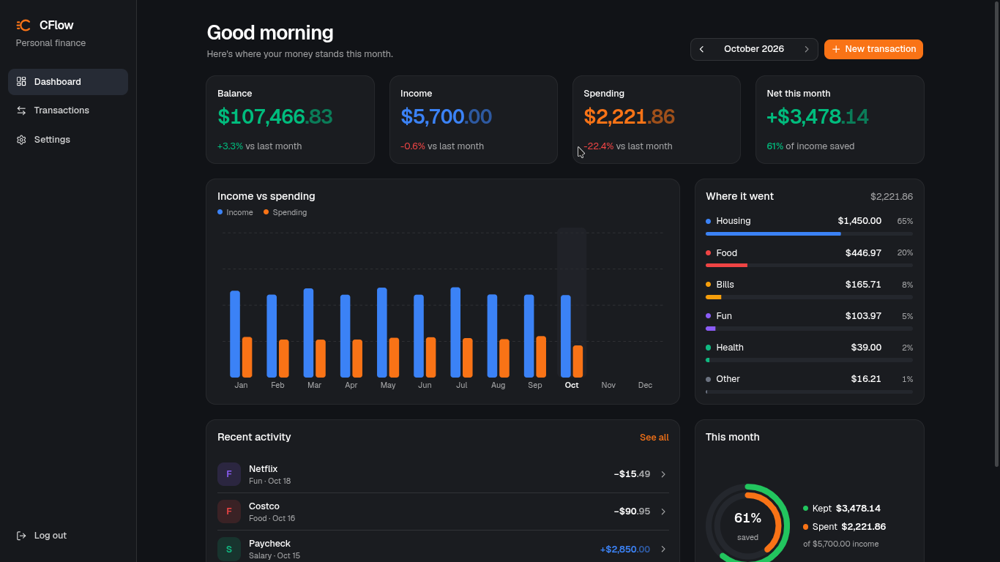
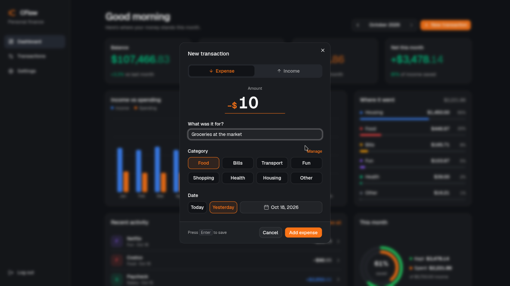
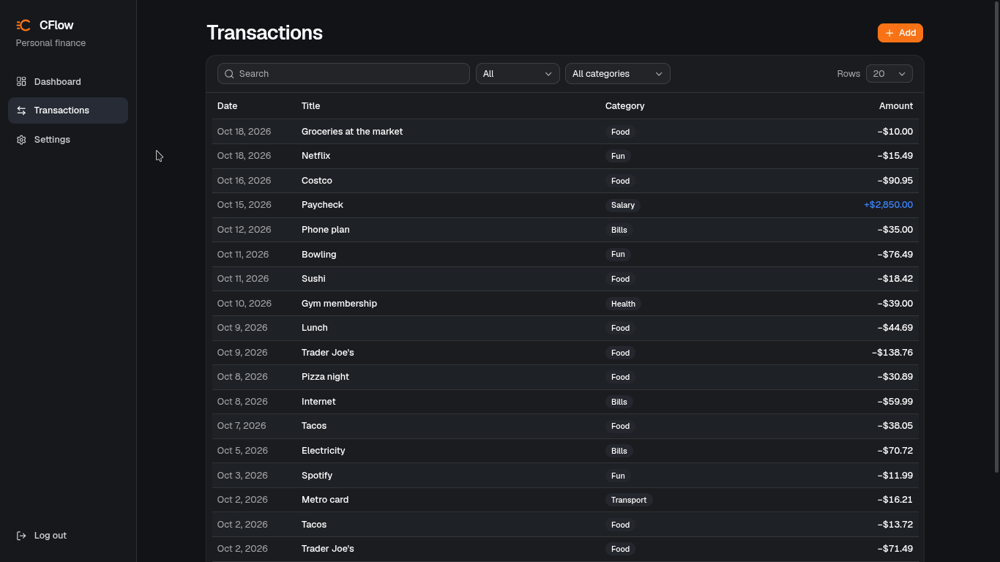
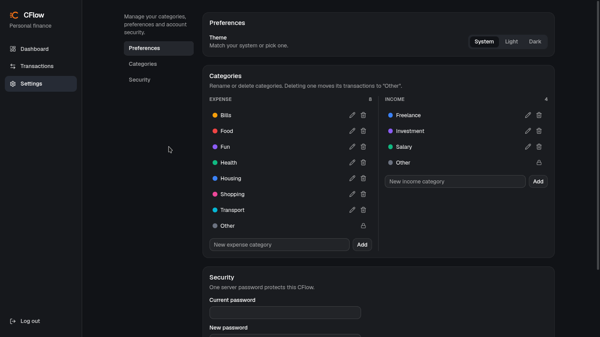

# CFlow (TypeScript)

A self-hosted, single-user port of the [BFlow Financial Engine](https://github.com/DiazzzDev/BFlow-Financial-Engine)
(Spring Boot) to Hono and libSQL, with a React web app. It tracks
one account: its transactions and categories.
Budgets and reports were ported too and are parked until they come back as
plugins.

Demo: https://cflow-demo.esauflores.com



| New transaction                                          | Transactions                                       |
| -------------------------------------------------------- | -------------------------------------------------- |
|  |  |



## Stack

| Layer           | Choice                                                                                                |
| --------------- | ----------------------------------------------------------------------------------------------------- |
| HTTP            | Hono on Bun: inside `vp dev` in development (`@hono/vite-dev-server`), `@hono/node-server` on its own |
| Database        | libSQL (SQLite), a local file                                                                         |
| Database access | plain SQL on `@libsql/client`; no ORM, no migrations                                                  |
| Validation      | zod                                                                                                   |
| Web             | React 19, react-router, TanStack Query, Tailwind                                                      |
| Tooling         | Bun (one package), Vite+ (format, lint, test), mise                                                   |

## Running

```sh
cp .env.example .env
mise install
bun install
mise run dev          # web app and API together on :5173 (PORT)
```

`vp dev` is one process: `@hono/vite-dev-server` hands `/api`
to the Hono app in `api/src/dev.ts` and Vite serves everything else, so the
browser talks to one origin and no CORS setup is needed. Editing an API file
reloads the API (the previous plugin host and database connection are closed
first). The port comes from `PORT`. `mise run start` (or `bun run start`) is production. `bun run build` builds
the web app into `web/dist/` (`vp build`) and bundles the server, from
`api/src/node.ts`, into `dist/server.mjs` (`vp pack`, dependencies left
external); then `bun dist/server.mjs` (or `node`) serves the app and the API on
one port (`PORT`), with `index.html` for client-side routes.

There are no migrations: on start, auth and every plugin (the ledger
included) create their tables with `CREATE TABLE IF NOT EXISTS`, and the
built-in categories are seeded into an empty database. By
default the database is `data/cflow.db` at the repo root; back it up by copying the file.

```sh
mise run check        # vp check: format, lint and type-check the API and the web app
mise run test
```

## Docker

```sh
docker compose up -d          # builds the image, then http://localhost:8080
```

The image (`Dockerfile`) builds the web app in one stage and runs it in a
slim Bun image with only the API's runtime dependencies. It serves the app
and the API on port 8080 as the unprivileged `bun` user, and keeps the
database at `/data/cflow.db` (the image sets `DATABASE_PATH`).

`compose.yaml` declares the service, its variables (plain values:
`APP_TIMEZONE`, `SESSION_TTL_DAYS`, `ALLOW_GUEST`, `CFLOW_PLUGINS`), the
`cflow-data` volume at `/data` and a health check on
`/health`. Edit the values there. To back up, copy the database out:
`docker compose cp cflow:/data/cflow.db ./cflow-backup.db`.

## Structure

The repo is one package: a single `package.json`, `node_modules` and
`vite.config.ts` at the root. `api/` and `web/` are source folders, each with
its own `tsconfig.json` (Node types vs. DOM and JSX). Imports use `@api/`
(`api/src`) and `@web/` (`web/src`).

```
package.json              every dependency, and scripts: check, test, dev, build, start
vite.config.ts            format and lint rules, aliases, web dev/build, api and web test projects
api/                      Hono API
  src/
    core/                 the kernel: config, db.ts (libSQL client and helpers), deps and clock,
                          HTTP envelope and errors, auth/
                          (server password, sessions, the session guard), hook names,
                          scheduler, route registry, money/date/period math
    plugins/              plugin contract (api.ts), name/settings checks (loader.ts),
                          and one folder per built-in plugin: ledger/ (the core plugin)
    app.ts                composition root: plugin host, built-in + installed plugins, Hono app
    node.ts               entry point: database, startCflow, server, graceful shutdown
  tests/                  mirrors src/: one folder per plugin, plus
    support/              the shared test harness (in-memory DB, test clock, logged-in client)
    core/ ledger/ plugins/
                          plugins/fixtures/notes is a plugin that exercises the whole contract
    architecture.test.ts  the layering rules, checked across the whole codebase
web/                      Vite+ with React, shadcn/ui (radix-nova), Motion and anime.js
                          (registry components copied in: the shadcn CLI cannot run in this layout)
  ANIMATIONS.md           how the animations work, and the rules that keep them smooth
  src/
    main.tsx              query client, routes, auth gate
    lib/                  api.ts (client, types, session token, queries), utils.ts (cn, formatting, theme)
    components/           ui/ (shadcn), Charts.tsx (bar and ring charts, plain SVG + Motion), Shell.tsx, TransactionDialog.tsx, DatePicker.tsx, Logo.tsx (anime.js draw),
                          Money.tsx (dimmed cents, anime.js count-up)
    pages/                Login.tsx, Dashboard.tsx (stats, chart, recent activity), Transactions.tsx,
                          Settings.tsx (categories, password)
  tests/                  API client, auth gate, transactions page (happy-dom)
```

| Plugin   | What it owns                                                                                                          |
| -------- | --------------------------------------------------------------------------------------------------------------------- |
| `ledger` | The core plugin, always loaded: the account's transactions and balance, and categories. Seeds the built-in categories |

There is one account. A transaction's `amount` is signed (negative is money
out), its category must match that direction, and the balance is the sum of
every transaction, so it is never stored and may go negative. A starting
balance is just a transaction without a category. Separate accounts can come
back as a plugin that links transactions to its own `accounts_*` tables.

Authentication is part of the kernel, not a plugin: `app.ts` mounts
`/api/auth` and puts every plugin route behind its session check.

The ledger is four files: `index.ts` (the plugin and its public exports),
`facade.ts` (the `ledger` service), and `categories.ts` and
`transactions.ts`, each holding its queries and its routes. Writes go
through `createTransaction`, `updateTransaction` and `deleteTransaction`,
which raise a hook after the commit.

CFlow is a small kernel plus plugins, on
[`@esauflores/plugin-sdk`](https://github.com/esauflores/plugin-sdk). The
ledger is a plugin too, registered before any other (`ledgerPlugin(deps)`):
in `setup` it mounts its routes and provides its facade as the `ledger`
service, and in `start` it seeds the built-in categories.
Installed plugins go through the same host.

These rules are enforced by `api/tests/architecture.test.ts`:

1. `core/` never imports from `plugins/`.
2. Plugins (one folder each under `plugins/`) import each other only through `index.ts`.
3. The plugin dependency graph has no cycles.
4. Only `app.ts` and `node.ts` wire the kernel and plugins together.

Each table is defined once, as the `CREATE TABLE` statement in the file that
queries it (e.g. `TRANSACTIONS_TABLE` in `ledger/transactions.ts`).

## Plugins

Plugins add features without changing CFlow: their own routes, tables, and
reactions to core changes. They are trusted code that runs
inside the server, so install only plugins you trust.

```sh
CFLOW_PLUGINS=@someone/cflow-plugin-receipts,./plugins/my-import   # packages or paths
CFLOW_PLUGIN_RECEIPTS_API_KEY=…                                    # settings for "receipts"
```

A plugin is a package whose `package.json` declares the CFlow major version it
targets and its entry (JavaScript, or TypeScript Node can strip):

```json
{
  "name": "cflow-plugin-receipts",
  "type": "module",
  "cflow": { "apiVersion": 0, "entry": "./dist/index.js" }
}
```

The entry's default export is a plugin
([SDK lifecycle](https://github.com/esauflores/plugin-sdk#lifecycle): setup → start → stop):

```ts
import type { CflowPlugin } from "…/api/src/plugins/api.ts"; // types only; not published as a package yet

const plugin: CflowPlugin<{ API_KEY: string }> = {
  name: "receipts", // a-z, 0-9, _; namespaces routes, tables and settings
  dependsOn: ["ledger"], // required to use("ledger")
  optionsSchema: z.object({ API_KEY: z.string() }), // checks its CFLOW_PLUGIN_RECEIPTS_* settings
  async setup(ctx) {
    await ctx.use("db").execute("CREATE TABLE IF NOT EXISTS receipts_files (id TEXT PRIMARY KEY, path TEXT NOT NULL)");
    ctx.use("routes").mount(`/plugins/${ctx.name}`, new Hono().get("/", …)); // behind auth
    ctx.hooks.on("transaction.created", (transaction) => {});
  },
  start(ctx) {
    const timer = setInterval(() => {}, 300_000); // periodic work is the plugin's own
    ctx.onDispose(() => clearInterval(timer));
  },
};
export default plugin;
```

Services a plugin can `use`:

| Service  | Purpose                                                                                                                    |
| -------- | -------------------------------------------------------------------------------------------------------------------------- |
| `ledger` | Transactions, balance and categories, with the REST API's validation (list in `dependsOn`)                                 |
| `db`     | The `@libsql/client` `Client`: plain SQL, so use any query library (or none) on top. Own tables must be prefixed `<name>_` |
| `routes` | `mount(path, hono)` under `/api`; plugins use `/plugins/<name>`                                                            |
| `clock`  | The app clock: use it instead of `new Date()`                                                                              |

`ctx.options`, `ctx.log`, `ctx.hooks`, `ctx.signal` and `ctx.onDispose` come
from the SDK. The rules:

- **Settings**: `CFLOW_PLUGIN_<NAME>_<KEY>` become `ctx.options.<KEY>`, where
  `<NAME>` is the specifier's last segment without `cflow-plugin-`.
- **Tables**: a plugin creates and evolves its own tables, prefixed
  `<name>_`, however it likes (e.g. `CREATE TABLE IF NOT EXISTS` in `setup`).
  They may reference core tables by foreign key. Plugins depend only on
  `@libsql/client`, so they can add any query library on top.
- **Hooks** (`transaction.created`, `.updated`, `.deleted`) fire after the change
  is committed, whether it came from the API or another plugin. A failing
  handler is logged and skipped; it cannot undo or block the change. Hooks are
  awaited, so do slow work outside the handler.
- **Startup checks**: an invalid or duplicate name (built-in names included), a
  different `apiVersion`, invalid options, a missing dependency or a failing
  `setup`/`start` stops the server.
- **Stability**: `api/src/plugins/api.ts` and the facades are the contract.
  Anything else in the API is internal.

## Authentication

Like Actual Budget, there are no user accounts. One server password
protects the instance:

1. `GET /api/auth/status` returns `{ bootstrapped }`.
2. `POST /api/auth/bootstrap { password }` runs once. It sets the password
   and returns a session token.
3. `POST /api/auth/login { password }` returns `{ token, expiresAt }`.
   After 5 failed attempts in 15 minutes it responds 429.
4. Send `Authorization: Bearer <token>` on every other request.
5. `POST /api/auth/logout` ends the session.
   `POST /api/auth/change-password { currentPassword, newPassword }`
   changes the password and revokes every other session.

Passwords are hashed with scrypt. Only the SHA-256 of each token is stored.

## API

Responses use the original envelope:
`{ success, message, data, timestamp, path }`. Errors add `code` and, for
validation failures, `errors: [{ field, code, message }]`. Lists take Spring
style `page`, `size` and `sort=field,asc|desc` parameters and return
`{ content, page: { size, number, totalElements, totalPages } }`.

Amounts are sent and returned as decimal numbers. Requests may also send them
as strings such as `"12.50"`. They are stored as integer cents.

| Area       | Routes under `/api`                                                                                                                                   |
| ---------- | ----------------------------------------------------------------------------------------------------------------------------------------------------- |
| Categories | `GET/POST /categories`                                                                                                                                |
| Account    | `GET /balance`, `GET /summary?year=` (dashboard totals), `GET/POST /transactions` (`query`, `type`, `categoryId`), `GET/PUT/DELETE /transactions/:id` |

## Differences from the Java version

These changes are intentional:

- **Single tenant.** Users, Cognito, shared wallets, invitations, member
  roles and contributor fields are gone, and so are plan limits and Wompi
  subscriptions.
- **One account.** Wallets, transfers, stored balances, overdraft checks and
  quick expenses are gone; expenses and incomes are one `transactions` table
  with signed amounts.
- **No budgets or dashboard yet.** They were ported, then parked to come back
  as plugins.
- **Error codes.** The original answered 404 for a wrong category type. Now
  bad input is 400 and 404 is only for missing records.
- **Leaner schema.** Columns nothing read are gone: `confidenceScore`,
  `editCount`, `categorizationChanges`, `autoGenerated` and category
  `systemDefined`. Categories must be `INCOME` or `EXPENSE`.
- **USD only, for now.** Transactions keep a `currency` column, which
  defaults to `USD` and is optional in requests, but `USD` is the only
  accepted value, so multi-currency support can come later as a plugin by extending
  `CURRENCIES` in `api/src/plugins/ledger/transactions.ts`.
- **No idempotency keys.** CFlow only tracks money, so a retried request at
  worst records a duplicate you can delete. The `Idempotency-Key` header and
  its table are gone.
- **Every response uses the envelope.** Successful deletes return 204.
- **English only.** Messages and chart labels (`Jan`, `Mon`, …) are in
  English; there is no localisation until it is needed.

## Not yet ported

Receipts and OCR (S3, Textract, SQS, SNS), file storage, CSV transaction
import and merchant detection, email templates, push notifications, legal
documents, the audit log, contact forms and account deletion.
